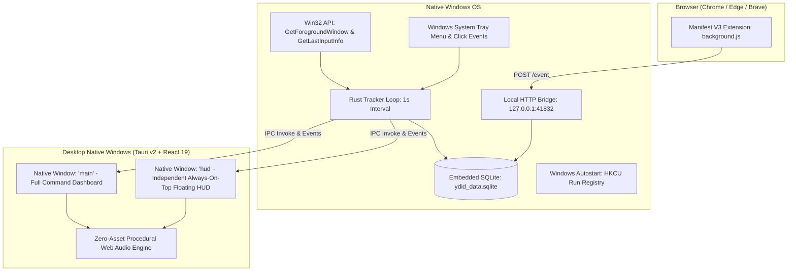

# 💀 YOUR DAY IS DYING (YDID)

<div align="center">

```text
██╗   ██╗ ██████╗ ██╗   ██╗██████╗     ██████╗  █████╗ ██╗   ██╗    ██╗███████╗    ██████╗ ██╗   ██╗██╗███╗   ██╗ ██████╗ 
╚██╗ ██╔╝██╔═══██╗██║   ██║██╔══██╗    ██╔══██╗██╔══██╗╚██╗ ██╔╝    ██║██╔════╝    ██╔══██╗╚██╗ ██╔╝██║████╗  ██║██╔════╝ 
 ╚████╔╝ ██║   ██║██║   ██║██████╔╝    ██║  ██║███████║ ╚████╔╝     ██║███████╗    ██║  ██║ ╚████╔╝ ██║██╔██╗ ██║██║  ███╗
  ╚██╔╝  ██║   ██║██║   ██║██╔══██╗    ██║  ██║██╔══██║  ╚██╔╝      ██║╚════██║    ██║  ██║  ╚██╔╝  ██║██║╚██╗██║██║   ██║
   ██║   ╚██████╔╝╚██████╔╝██║  ██║    ██████╔╝██║  ██║   ██║       ██║███████║    ██████╔╝   ██║   ██║██║ ╚████║╚██████╔╝
   ╚═╝    ╚═════╝  ╚═════╝ ╚═╝  ╚═╝    ╚═════╝ ╚═╝  ╚═╝   ╚═╝       ╚═╝╚══════╝    ╚═════╝    ╚═╝   ╚═╝╚═╝  ╚═══╝ ╚═════╝ 
```

**Time won't wait.** • *Watch your day disappear in real time.*

[](https://tauri.app/)
[](https://www.rust-lang.org/)
[](https://react.dev/)
[](https://www.typescriptlang.org/)
[](https://www.sqlite.org/)
[](#-privacy-first-guarantee)

</div>

---

## 🧭 Overview & Core Philosophy

**YOUR DAY IS DYING (YDID)** is not another generic Pomodoro timer, cheerful gamified habit tracker, or intrusive spyware dashboard. It does not preach, motivate, or reward you with colorful confetti or artificial streaks.

Instead, YDID is engineered as a **relentless, physical time-monitoring instrument**:

> **TIME PASSES → ACTIVITY IS TRACKED → THE DAY SHRINKS → NOTIFICATION INTERRUPTS → USER BECOMES AWARE → USER CHANGES BEHAVIOR**

### The Central Metaphor: A Depleting Life Bar
Your day is treated like a finite video game health bar:
```text
YOUR DAY

18:19

████████████████████████░░░░░░░░
             72.6% GONE

4h 56m REMAINING TODAY
```

---

## ⚡ Tech Stack Architecture



---

## 🚀 How to Run This Project

### 📋 Prerequisites
Ensure the following tools are installed on your machine:
- **Node.js** (v18 or higher): `node -v`
- **Rust & Cargo** (v1.75 or higher): `rustc --version`
- **Windows C++ Build Tools**: (via Visual Studio Installer with *Desktop development with C++*)

---

### Step 1: Install Dependencies
Open a terminal in the root folder (`d:\Productive_project`):
```bash
npm install
```

---

### Step 2: Running the Application

You have two ways to run the project depending on your workflow:

#### Option A: Native Desktop App (Recommended) 🖥️
This runs the full **native Windows desktop application** (`.exe`). It is **completely independent of Chrome or any browser**. Even if you close all browsers, the widget remains on your screen floating on top of all other software!

```bash
# Run in development mode with hot-reloading
npm run tauri dev
```
*(Or directly launch the compiled binary: `.\src-tauri\target\debug\tauri-app.exe`)*

#### Option B: Web Browser Simulator Preview 🌐
If you want to rapidly inspect the React UI inside your browser:
```bash
npm run dev
```
Open **`http://localhost:1420/`** in your browser.  
> **💡 Tip**: You can open **`http://localhost:1420/?view=widget`** to directly view the compact floating widget view in your browser.

---

### Step 3: Install the Browser Extension (Optional but Recommended) 🌐

The extension automatically tracks active browser tab domains (e.g. `youtube.com`, `github.com`, `reddit.com`) and reports them to the desktop app over a local loopback bridge (`127.0.0.1:41832`).

1. Open **Google Chrome**, **Microsoft Edge**, or **Brave**.
2. Navigate to: `chrome://extensions/`
3. In the top-right corner, turn ON **Developer mode**.
4. Click the **Load unpacked** button.
5. Select the `extension/` directory inside this repository:
   ```text
   d:\Productive_project\extension
   ```
6. Pin the **YDID** icon in your browser toolbar. When active, clicking the icon will display connection status: `BRIDGE CONNECTED`.

---

### Step 4: Compiling & Distributing the Windows Application 📦

To build the optimized production release installer and standalone `.exe`:
```bash
npm run tauri build
```

This compiles the release binary and packages a standard Windows NSIS setup wizard:

- **Windows Setup Installer**:
  ```text
  YourDayIsDying-Setup.exe
  (also located at src-tauri/target/release/bundle/nsis/YOUR DAY IS DYING_1.0.0_x64-setup.exe)
  ```
  *Features a standard Windows install wizard, Start Menu entry, Desktop shortcut, and Windows uninstaller.*

- **Standalone Release Executable**:
  ```text
  src-tauri/target/release/tauri-app.exe
  ```

---

## 🎛 The Native Floating HUD & Windows Desktop Architecture

### 1. Genuine Native Floating Window (Not a CSS Overlay)
- The HUD is a **separate native OS desktop window** (`label: "hud"`) configured with `decorations: false`, `transparent: true`, and `alwaysOnTop: true`.
- You can drag it outside the dashboard window and position it anywhere on your desktop.
- It floats above **Chrome, VS Code, Slack, games, and terminal windows**.
- **Draggable Anywhere**: The entire chassis and header grip has `data-tauri-drag-region`, allowing seamless multi-monitor dragging.
- **Pill Dial Mode**: Click the chevron down button (<kbd>▼</kbd>) to collapse the HUD into a compact floating pill dial (`4h 44m | 73.6%`). Click expand (<kbd>▲</kbd>) to return to the full instrument.

### 2. Multi-Monitor Persistence & Bounds Safety
- Whenever the HUD is moved, its physical coordinates `(x, y)` are saved to SQLite (`ydid_data.sqlite`).
- Upon launch, YDID queries all connected monitors via `available_monitors()`. If saved coordinates fall outside all current displays (e.g. after unplugging an external monitor), it gracefully resets to the bottom-right corner of the primary display.
- **Reset Position**: Click the reset button (<kbd>↺</kbd>) in the HUD header or Settings to instantly center it in the bottom-right corner.

### 3. Independent Application Lifecycle
- When you click the close button (<kbd>✕</kbd>) on the main command dashboard, **the application and HUD keep running**.
- Tauri intercepts `WindowEvent::CloseRequested` to hide the dashboard without killing the background tracking loop or the HUD.
- The HUD continues counting down and showing your active application in real time.

### 4. Windows System Tray Integration
- The YDID icon lives in the Windows notification area (System Tray).
- Clicking the tray icon toggles the main command dashboard.
- Right-clicking the tray icon opens the context menu:
  - **Open Dashboard**: Shows and focuses the main command window.
  - **Show / Hide HUD Widget**: Toggles HUD visibility independently.
  - **Pause / Resume Tracking**: Toggles the 1-second activity tracker.
  - **Quit YDID**: Completely shuts down the application, HUD, and background workers (`app.exit(0)`).

### 5. Start with Windows (Autostart)
- YDID can launch automatically when Windows boots.
- Managed directly via the Windows Registry (`HKEY_CURRENT_USER\Software\Microsoft\Windows\CurrentVersion\Run`).
- Can be enabled during the first-run onboarding wizard or toggled anytime in the **Settings → Desktop** tab.

---

## 🔊 Procedural Web Audio Engine (Zero Sound Files)

All audio in YDID is generated procedurally using the **Web Audio API** (`src/services/audio.ts`). No MP3, WAV, or external audio files are loaded:

| Sound Type | Synthesis Technique | Emotional Impact |
|:---|:---|:---|
| **Normal Tick** | Dual high-frequency bandpass-filtered noise burst (0.015s) | Subtle, physical mechanical clock tooth engagement. |
| **Distraction Drop** | Sine wave sweeping from 95Hz down to 28Hz with soft sub-bass saturation | Sinking feeling; subtle reminder of wasted time. |
| **Focus Click** | High-Q 1800Hz resonant bandpass burst with logarithmic decay | Tactile, clean positive feedback upon focus action. |
| **Warning Pulse** | Dual 60Hz and 72Hz sine wave simulating an elevated heartbeat | Biological urgency when day enters critical >85% elapsed. |
| **Hour Chime** | Multi-harmonic triad (C5, G5, C6) with lingering metallic shimmer | Time checkpoint marking the departure of another hour. |
| **End of Day** | Low-frequency 42Hz saw drone with slow lowpass filter modulation | Weighty atmospheric acknowledgment that today is finished. |

---

## 📂 Project Structure

```text
d:\Productive_project\
├── package.json                 # Project dependencies and npm scripts
├── vite.config.ts               # Vite configuration with Tailwind CSS & Tauri plugins
├── tsconfig.json                # TypeScript compiler configuration
├── index.html                   # Single-page application entry point
├── README.md                    # Product documentation & running guide
├── YourDayIsDying-Setup.exe     # Windows NSIS Production Setup Installer
│
├── extension/                   # Chrome / Chromium Manifest V3 Extension
│   ├── manifest.json            # Extension manifest definition
│   ├── background.js            # Active tab tracker & local bridge reporter
│   ├── popup.html               # Extension connection popup UI
│   ├── popup.js                 # Popup status scripts
│   └── icon*.png                # Extension icons
│
├── src-tauri/                   # Rust Backend (Tauri v2)
│   ├── Cargo.toml               # Rust crates (tauri, rusqlite, winreg, tiny_http, chrono, windows)
│   ├── tauri.conf.json          # Multi-window definitions, NSIS packaging & icons
│   └── src/
│       ├── main.rs              # Desktop executable entry point
│       ├── lib.rs               # Multi-window IPC commands, system tray menu & CloseRequested hook
│       ├── autostart.rs         # Windows registry autostart manager (HKCU Run key)
│       ├── models.rs            # Core data types (DayStatus, Activity, Rules, Debt, Settings)
│       ├── db.rs                # SQLite database migrations, chunk coalescing & queries
│       ├── tracker.rs           # Native Win32 foreground window & idle tick tracking
│       └── server.rs            # Local HTTP bridge server (127.0.0.1:41832)
│
└── src/                         # Frontend Application (React 19 + TypeScript)
    ├── main.tsx                 # React DOM mount point
    ├── App.tsx                  # Window view router (?view=hud) & state orchestrator
    ├── index.css                # Dark neomorphism design system & tokens
    │
    ├── types/
    │   └── index.ts             # TypeScript interfaces mirroring Rust models
    │
    ├── services/
    │   ├── api.ts               # Tauri IPC invoke bridge & desktop window controls
    │   └── audio.ts             # Web Audio procedural synthesis engine
    │
    └── components/
        ├── Header.tsx           # Brand header, clock, pause & native HUD toggle button
        ├── DesktopHudView.tsx   # Native floating HUD instrument (drag region, pill mode)
        ├── CountdownHero.tsx    # Central physical countdown clock & life bar
        ├── CurrentActivityBadge.tsx # Real-time active application & domain badge
        ├── StatsGrid.tsx        # 4 category cards (Productive, Neutral, Distraction, Idle)
        ├── TimeDebtPanel.tsx    # Asymmetrical debt ledger with repayment actions
        ├── OpportunityCostPanel.tsx # Economic potential lost calculator
        ├── TimelineView.tsx     # Chronological daily ribbon with category filtering
        ├── WeeklyAnalytics.tsx  # 7-day rolling report & biggest time sink analysis
        ├── FocusModeModal.tsx   # Dedicated focus session countdown with distraction alert
        ├── EndOfDayReportModal.tsx # Honest end-of-day summary without cheerleading
        ├── SignatureNotification.tsx # Context-aware signature non-toast drawer
        ├── SettingsModal.tsx    # Desktop integration tab, autostart, rules & sounds
        └── OnboardingModal.tsx  # First-run alignment & start with Windows option
```

---

## 🔒 Privacy-First Guarantee

- **100% Local Storage**: All activity logs, timelines, and statistics are stored in an embedded SQLite database (`ydid_data.sqlite`) stored locally on your machine.
- **Zero Telemetry**: No Google Analytics, no Mixpanel, no Sentry, no cloud servers.
- **Zero Surveillance**: YDID **does not** capture keystrokes, passwords, screenshots, webcam video, or audio. It only inspects the active window executable name (`code.exe`) and web domain (`github.com`) to determine category classification.
- **Export & Delete Anytime**: You can export all tracked data as a single JSON file or wipe the entire database with one click in the Settings modal.

---

## 🛠 Useful Terminal Commands

| Action | Command |
|:---|:---|
| **Run Desktop App (Dev)** | `npm run tauri dev` |
| **Run Web Preview** | `npm run dev` |
| **Build Frontend** | `npm run build` |
| **Check Rust Code** | `cd src-tauri && cargo check` |
| **Build Desktop .exe** | `npm run tauri build` |

---

## 📄 License

MIT License • Free and open-source.

---

<div align="center">

**YOUR DAY IS DYING**  
*Time won't wait. Use what you have left.*

</div>
